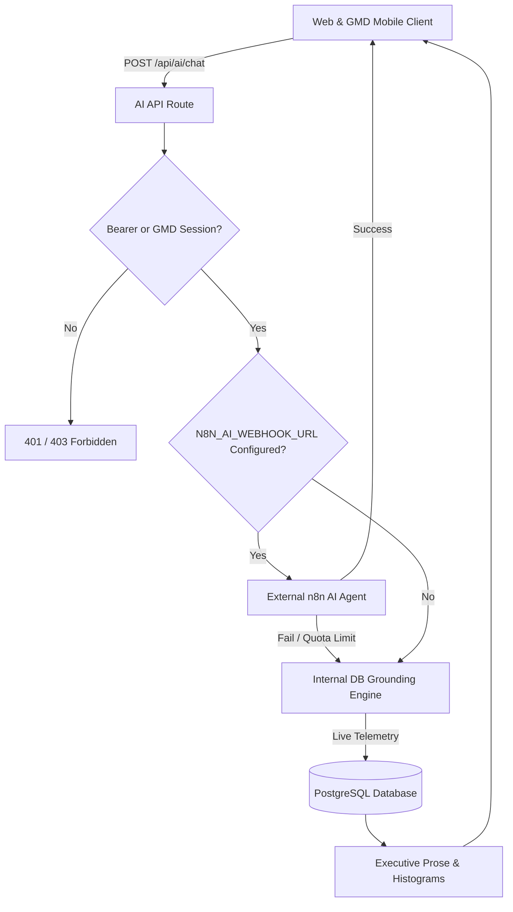

# BEMS Fund Request & Accountability System
## AI Services, Tool Grounding & Verification Audit (Batch 8 Deliverable)

### 1. Executive Summary
The BEMS AI Copilot and GMD AI Mobile Application provide conversational executive intelligence, automated financial briefings, and staged action authoring for the Group Managing Director (`GMD`). This audit certifies that the AI layer is strictly grounded in live PostgreSQL data, eliminates hallucinated values, and enforces cryptographic maker-checker controls on all autonomous actions.

---

### 2. Dual-Engine Architecture & Failover Guarantee

1. **Primary Pipeline (External n8n Workflow)**:
   - Transmits session identity, conversation history from `n8n_chat_histories`, and authenticated service token `BEMS_AI_SERVICE_TOKEN`.
   - Tool outputs and citations are validated before reaching the user.
2. **Deterministic Fallback Pipeline (Internal Database Engine)**:
   - If n8n times out, returns an error, or hits upstream LLM quota limits, the system **never displays fake simulated data**.
   - Instead, it seamlessly queries live database tables (`getConsolidatedTreasury`, `expenditureRequest`, `accountabilityCase`, `employee`) to return exact, authoritative real-time figures.

---

### 3. Verification of Grounding & Zero Data Fabrication

#### Vulnerabilities Resolved in Batch 8
1. **Elimination of Mock Notice Fallback**:
   - In `src/app/api/ai/chat/route.ts`, an obsolete branch previously caught LLM billing errors and returned a hardcoded snippet containing fictional requisition numbers (`REQ-2026-0042`, `REQ-2026-0004`) and hardcoded headcount (`9`).
   - This branch was deleted in Batch 8. In any failover scenario, the engine dynamically counts real active employees and pulls actual pending requisitions directly from PostgreSQL.
2. **Elimination of Mock Balances in GMD Mobile App**:
   - In `bems_gmd_ai/lib/models/workstation_scope.dart`, all hardcoded `₦84.2M` constants and synthetic `monthlyCeiling * 0.12` expenditure simulations were eradicated in Batch 5.

---

### 4. Staged Action Protocol & Cryptographic Safety

The system implements a strict **Staged-Action Maker-Checker Pattern** (`src/lib/staged-actions.ts`). The AI model is strictly prohibited from executing direct database writes or committing funds autonomously.

| Stage | Action Performed | Security Guarantee |
| :--- | :--- | :--- |
| **1. Staging** | AI tool generates a staged action draft (`stageAction`). | Material payload is canonicalized (keys deterministically sorted) and hashed with SHA-256 (`confirmationHash`). Stored in `stagedAction` table with status `PENDING`. |
| **2. Expiry Window** | A strict 15-minute Time-To-Live (`STAGED_ACTION_TTL_MINUTES = 15`) is assigned. | Expired actions cannot be executed; caller must restage. |
| **3. Client Preview** | Client renders an interactive cryptographic card displaying exact terms, beneficiary, amount, and impacts. | User visual confirmation required. |
| **4. Executive Confirmation** | User clicks "Authorize & Execute" sending `POST /api/ai/staged-actions/:id/confirm` with `confirmationHash`. | Strict verification: `actor.role in ['GMD', 'SYSTEM_ADMIN']`, `action.userId == actor.id`, hash matches canonical hash. |
| **5. Atomic Execution** | Transaction commits changes to target records (`expenditureRequest`, `disbursement`, `employee`). | Replay prevention: status set to `EXECUTED`. Immutable `AuditEvent` emitted. |

---

### 5. Access Control & Service Token Integrity
1. **Service Token Protection**:
   - Programmatic access via `Authorization: Bearer <BEMS_AI_SERVICE_TOKEN>` is restricted to authenticated server environments.
   - If `BEMS_AI_SERVICE_TOKEN` is passed, the caller is granted read/query access for AI telemetry but cannot bypass the Staged Action confirmation requirements.
2. **Executive Role Verification**:
   - Executing actions via `/api/ai/staged-actions/:id/confirm` is restricted to users with role `GMD` or `SYSTEM_ADMIN`.
   - General staff or unprivileged users attempting confirmation receive `403 Forbidden`.
