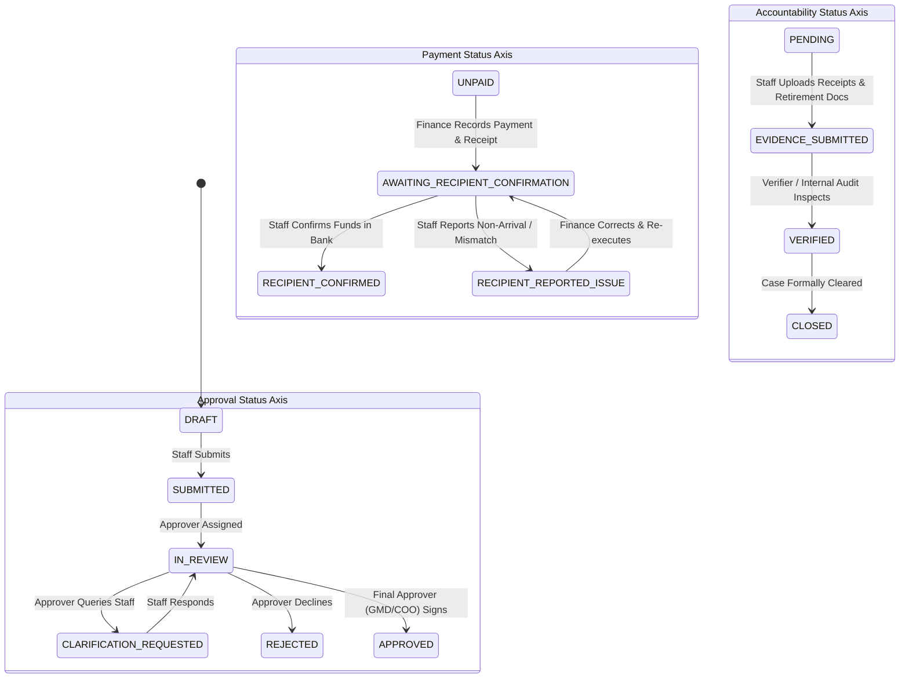

# BEMS System Data Consistency & Database Integrity Matrix

This audit document details the schema models, multi-tenant isolation, state machines, financial precision standards, and transaction boundaries across the BEMS Fund Request & Accountability System.

---

## 1. Schema Models & Multi-Tenant Scoping Audit

All database entities must respect multi-tenant isolation under `Organization` (`groupId` / `subsidiaryId`).

| Prisma Model | Primary Tenant Key | Cascade Rule | Scoping Status | Audit Notes |
|---|---|---|---|---|
| `Organization` | `id` (PK) | Parent Group self-relation | Verified | Hierarchical (Group vs Subsidiary). |
| `CompanyBankAccount` | `organizationId` | `onDelete: Cascade` | Scoped via `organizationId` | Fixed in Batch 2 to filter by active subsidiary scope. |
| `WorkspaceSetting` | `organizationId` | `onDelete: Cascade` | Scoped via `organizationId` | Unique on `[organizationId, key]`. |
| `Department` | `organizationId` | `onDelete: Restrict` | Scoped via `organizationId` | Scoped to legal subsidiary entity. |
| `Employee` | Global `id` | - | Enterprise Global | Can belong to multiple subsidiaries via `EmployeeAssignment`. |
| `EmployeeAssignment`| `subsidiaryId` | `onDelete: Restrict` | Explicitly Scoped | Resolves active subsidiary for staff fund requests. |
| `EmploymentAgreement`| `employerEntityId` | `onDelete: Restrict` | Explicitly Scoped | Legal contract anchor entity. |
| `CompensationAgreement`| via `employmentAgreement` | `onDelete: Restrict` | Explicitly Scoped | Gross salary stored in integer kobo (`grossMinor`). |
| `CostAllocation` | `subsidiaryId` | `onDelete: Restrict` | Explicitly Scoped | Multi-entity split percentage (e.g. 60% BemsSoft, 40% BemsLog). |
| `Vendor` | Global registry | - | Shared Registry | Unique vendor code, optional tax ID, banking info. |
| `ExpenditureRequest`| `subsidiaryId`, `groupId` | `onDelete: Restrict` | Explicitly Scoped | Single source of truth for fund requests. |
| `RequestChannel` | via `requestId` | `onDelete: Restrict` | Scoped via request | Dedicated channel for messages and audit logs. |
| `ChannelMessage` | via `channelId` | `onDelete: Restrict` | Scoped via request | Real-time chat & audit log timeline. |
| `ApprovalPolicy` | `scopeSubsidiaryId` | `onDelete: Restrict` | Optional subsidiary scope | Multi-tiered amount limits and required roles. |
| `ApprovalStep` | via `requestId` | `onDelete: Restrict` | Scoped via request | Sequential stages with `stageIndex` (1 to 3). |
| `Disbursement` | `payerOrgId`, `requestId` | `onDelete: Restrict` | Explicitly Scoped | Off-platform bank transfer record with SHA256 receipt. |
| `RecipientPaymentConfirmation` | `disbursementId` | `onDelete: Restrict` | Scoped via disbursement | Staff verification loop (`RECEIVED`, `NOT_RECEIVED`, `MISMATCH`). |
| `PaymentReceipt` | `disbursementId` | `onDelete: Restrict` | Scoped via disbursement | SHA256 deduplicated bank transfer slip. |
| `PaymentVerification`| `disbursementId` | `onDelete: Restrict` | Scoped via disbursement | Optional third-party verifier stamp. |
| `AccountabilityCase`| `requestId` | `onDelete: Restrict` | Scoped via request | Retirement deliverable tracking with 14-day / 72-hour SLAs. |
| `FollowupTask` | via `accountabilityCaseId` | `onDelete: Restrict` | Scoped via case | Post-disbursement action item for staff. |
| `PayrollPeriod` | `groupId` | `onDelete: Restrict` | Group-level scope | Monthly lock status (`OPEN`, `LOCKED`, `ARCHIVED`). |
| `PayrollBatch` | via `periodId`, `paymentEntityId` | `onDelete: Restrict` | Explicitly Scoped | Snapshot of calculated gross/net/deductions. |
| `PayrollItem` | via `batchId` | `onDelete: Restrict` | Explicitly Scoped | Per-staff calculated line with `netMinor` and `grossMinor`. |
| `PayrollItemAllocation`| `subsidiaryId` | `onDelete: Restrict` | Explicitly Scoped | Minor unit cost charged to each subsidiary entity. |
| `IntercompanyNote` | `sourceEntityId`, `targetEntityId` | `onDelete: Restrict` | Dual Entity Scope | Automated debit/credit note between group subsidiaries. |
| `AuditEvent` | `groupId`, `subsidiaryId` | `onDelete: Restrict` | Tenant & Group Scoped | Immutable audit trail with SHA256 hashes and correlation IDs. |
| `Budget` | `organizationId` | `onDelete: Restrict` | Explicitly Scoped | Annual/Quarterly budget allocation per subsidiary. |
| `BudgetLine` | via `budgetId` | `onDelete: Cascade` | Scoped via budget | Departmental OPEX/CAPEX allocation and spent tracking. |
| `ThreeWayMatchRecord`| via `requestId` | `onDelete: Restrict` | Scoped via request | Compares PO amount vs Invoice vs GRN. |
| `StagedAction` | `userId` | `onDelete: Restrict` | Executive Scoped | 15-minute time-locked staged actions with SHA256 signature. |

---

## 2. Status Axis Alignment & State Machines

The system defines 3 independent status axes for every fund request. These axes must NEVER be merged into a single field because they represent distinct lifecycle phases.

### Transition Consistency Rules:
1. **Disbursement Pre-condition**: A payment can ONLY be recorded if `approvalStatus === 'APPROVED'`.
2. **Accountability Trigger**: When a payment is recorded or recipient-confirmed, an `AccountabilityCase` is automatically spawned with `status = 'OPEN'`.
3. **Advance Retirement SLA**: Advances require evidence within 72 hours of recipient confirmation. Non-advance ordinary requests default to 14 days.
4. **Closed Case Pre-condition**: A case can only transition to `CLOSED` after `EVIDENCE_SUBMITTED` has been validated.

---

## 3. Financial Units & Precision Standard

All monetary calculations in the database MUST adhere strictly to:
- **Base Storage Rule**: Minor currency units (e.g., Nigerian Kobo = ₦ * 100) stored as **`BigInt`** (`amountMinor`, `grossMinor`, `netMinor`, `totalAmountMinor`).
- **Rounding Rule**: Floats from user input or UI forms are immediately converted using `BigInt(Math.round(amount * 100))`. No floating-point arithmetic is performed inside database transactions.
- **API Projection Symmetry**: All API route responses must project:
  - `amountMinor`: `Number(amountMinor)` (for clients requiring exact integer precision)
  - `amount`: `Number(amountMinor) / 100` (float Naira for backwards compatibility)
  - `amountNaira`: `Number(amountMinor) / 100` (float Naira for mobile apps)
  - `amountFormatted`: `"₦...,..."` (formatted string with commas and currency symbol)

---

## 4. Transaction Boundaries & Mutation Atomicity

Every multi-table state transition must execute inside a `prisma.$transaction`:

| Endpoint | Operation | Transaction Scope | Handled in Batch 2? |
|---|---|---|---|
| `POST /api/requests/create` | Request Creation | `ExpenditureRequest` + `RequestChannel` + `ChannelMessage` + `ApprovalStep` | **Verified** |
| `POST /api/approvals/decide` | Approval Decision | `ApprovalStep` + `ExpenditureRequest` + `SystemNotification` + `ChannelMessage` + `AuditEvent` | **Verified** |
| `POST /api/disbursements` | Payment Recording | `Disbursement` + `PaymentReceipt` + `ExpenditureRequest` + `AccountabilityCase` + `FollowupTask` | **Verified** |
| `POST /api/disbursements/confirm` | Staff Confirmation | `RecipientPaymentConfirmation` + `Disbursement` + `ExpenditureRequest` + `AccountabilityCase` + `ChannelMessage` + `AuditEvent` + `SystemNotification` | **Verified** |
| `POST /api/accountability/close` | Retirement & Closure | `Attachment` + `AccountabilityCase` + `ExpenditureRequest` + `ChannelMessage` + `AuditEvent` | **Verified** |
| `POST /api/intercompany` | Note Issuance | `IntercompanyNote` + `AuditEvent` | **Verified** |

---

## 5. Batch 2 Discrepancies & Remediations

### Discrepancy DB-001: Runtime Crash on `where.amount` in Requests List
- **Component**: `src/app/api/requests/route.ts:54`
- **Issue**: Handled query parameter `min_amount` by setting `where.amount = { gte: minAmount }`. `ExpenditureRequest` has no `amount` field in Prisma schema, causing an unhandled runtime exception if `min_amount` was passed.
- **Fix Applied**: Updated to `where.amountMinor = { gte: BigInt(Math.round(minAmount * 100)) }`.

### Discrepancy DB-002: Fictional 33% Equal Split in Payroll Summary
- **Component**: `src/app/api/payroll/summary/route.ts:52`
- **Issue**: Hardcoded subsidiary share percentages to `Math.round(100 / orgs.length)%` instead of reading live contracts and cost allocations.
- **Fix Applied**: Rewrote route to query `CompensationAgreement` with `costAllocations` and `EmployeeAssignment`, computing true proportional allocation per subsidiary entity.

### Discrepancy DB-003: Pipeline Inconsistency between Analytics and Treasury
- **Component**: `src/app/api/analytics/route.ts:9`
- **Issue**: Defined `unpaidStatuses = ['UNPAID']`, omitting `RECIPIENT_REPORTED_ISSUE`. When a staff member flags a payment issue, the request remains in need of disbursement, but was dropped from analytics unpaid forecast while included in treasury pending pipeline.
- **Fix Applied**: Updated `unpaidStatuses = ['UNPAID', 'RECIPIENT_REPORTED_ISSUE']`.

### Discrepancy DB-004: Bank Account Balance Not Decremented on Payment
- **Component**: `src/app/api/disbursements/route.ts` vs `CompanyBankAccount`
- **Issue**: `CompanyBankAccount.balance` is static; creating a disbursement does not deduct from the recorded bank account balance. Treasury balances reflect manual balance updates rather than real-time net ledger balance.
- **Remediation**: Logged in `AUDIT_FINDINGS.md` (`FIN-001`) for Batch 7 financial reconciliation.

### Discrepancy DB-005: Hardcoded Monthly Burn Rate in Financial Metrics
- **Component**: `src/lib/financial-metrics.ts:91`
- **Issue**: `const estimatedMonthlyBurn = 30000000;` (₦30M/mo) is hardcoded to compute runway months (`totalCash / 30000000`).
- **Remediation**: Logged in `AUDIT_FINDINGS.md` (`DATA-002`) to dynamically compute monthly burn rate from trailing 90-day disbursements + monthly payroll.
