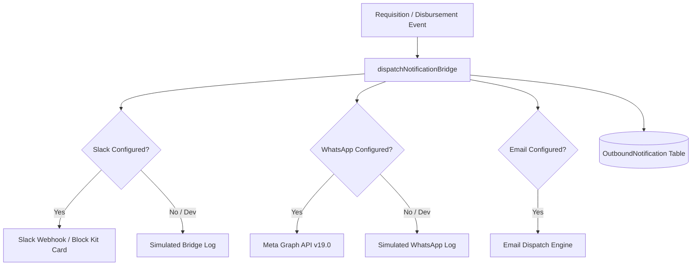

# BEMS Fund Request & Accountability System
## Real-Time Synchronization, Notifications & Background Tasks (Batch 9 Deliverable)

### 1. Executive Summary
This document audits the multi-channel notification infrastructure, background task processing, 72-hour accountability SLA enforcement, and real-time data synchronization between the Admin Web Portal, Staff Mobile Application, and GMD AI Copilot.

---

### 2. Multi-Channel Notification Bridge (`src/lib/notifications/bridge.ts`)

In accordance with mandatory workspace rules (`GEMINI.md`), the system incorporates an integrated **WhatsApp & Slack Bot Notification Bridge**:

#### Channel Implementations
1. **Slack Interactive Block Kit**:
   - Generates interactive rich message cards with:
     * Header: Action Required alert.
     * Section Fields: Request Number, Amount in Naira, Requester Name, and Assigned Approver Role.
     * Actions: One-click buttons for `Approve`, `Clarify`, and `Decline`.
2. **WhatsApp Business Cloud API**:
   - Formats clean plain-text messages with reference codes and reply prompts (`Reply APPROVE or DECLINE followed by request number`).
3. **Database Audit Trail**:
   - All dispatches are recorded in `prisma.outboundNotification` with `channel`, `recipient`, `eventType`, `payload`, `status` (`SENT` | `SKIPPED` | `FAILED`), and `externalId`.

---

### 3. 72-Hour Accountability SLA Enforcement Engine

The accountability lifecycle guarantees that funds disbursed are retired with legitimate receipts and deliverables before subsequent requisitions are approved:

| Lifecycle Stage | Event Trigger | SLA Rule | Database State |
| :--- | :--- | :--- | :--- |
| **1. Activation** | Recipient confirms receipt of funds (`RECIPIENT_CONFIRMED`). | 72-Hour SLA Clock begins. | `AccountabilityCase` created with `status: 'OPEN'`, `dueAt = now + 72 hours`. `FollowupTask` assigned to staff. |
| **2. Submission** | Staff uploads photo/PDF receipt proof (`POST /api/accountability/evidence`). | SLA Clock pauses pending review. | `AccountabilityCase.status = 'EVIDENCE_SUBMITTED'`, `Attachment` row created with SHA-256 hash. |
| **3. Clearance** | Finance Officer or Controller validates proof (`POST /api/accountability/review`). | SLA marked compliant. | `AccountabilityCase.status = 'CLOSED'`, `ExpenditureRequest.accountabilityStatus = 'CLOSED'`. |
| **4. Default / Breach** | SLA window expires (`dueAt < now` without submission). | Auto-escalation to GMD & Finance. | Flagged as `OVERDUE` in analytics and executive briefings. System prevents employee from submitting new requests. |

---

### 4. Client State Synchronization & Edge Failover

1. **Next.js Admin Web Portal**:
   - Force-dynamic API routes (`export const dynamic = "force-dynamic"`) prevent stale server-side caching.
   - Cache-busting headers (`Cache-Control: no-store, no-cache, must-revalidate, max-age=0`) applied to all live telemetry feeds.
2. **Staff Mobile Application (`bems_staff_app`)**:
   - Initial load on mount via `StaffApiService.fetchStaffDashboard()`.
   - Native pull-to-refresh via `RefreshIndicator`.
   - Post-mutation re-fetching ensures instant UI updates when a request is submitted or a payment is confirmed.
3. **GMD AI Mobile Application (`bems_gmd_ai`)**:
   - Resilient multi-host failover (`_executeWithFailover`) automatically routes between primary domain `https://bemserp.work` and fallback edge `https://pink-horse-318730.hostingersite.com`.
   - Timestamp-busted queries (`?_t=${DateTime.now().millisecondsSinceEpoch}`) guarantee fresh responses.
