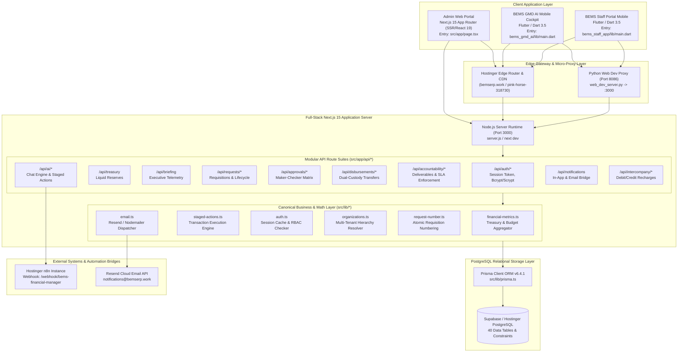
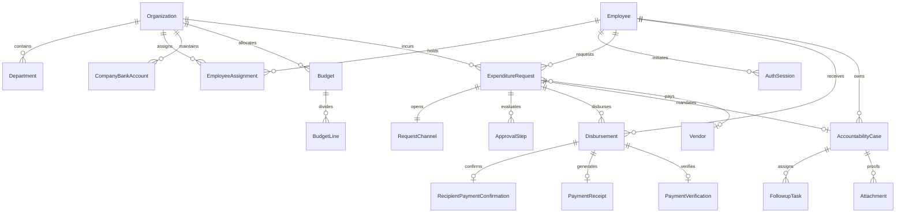

# System Architecture & Data Flow Map

## 1. High-Level Enterprise Topology

---

## 2. Applications & Entry Point Directory Layout

| Application | Technology Stack | Entry Point | Core Responsibilities |
| :--- | :--- | :--- | :--- |
| **Admin Web Portal** | Next.js 15, React 19, Tailwind CSS | [src/app/page.tsx](file:///Users/henry/Documents/Fund%20Request%20System/src/app/page.tsx) | Executive Cockpit, Treasury Registry, Requisition Lifecycle, Corporate Budgets, Intercompany Notes, Vendor KYC, Payroll. |
| **GMD AI Mobile Cockpit** | Flutter 3.5, Dart | [bems_gmd_ai/lib/main.dart](file:///Users/henry/Documents/Fund%20Request%20System/bems_gmd_ai/lib/main.dart) | Group Managing Director real-time liquidity dashboard, AI conversational intelligence, pending maker-checker approvals, biometric authentication. |
| **BEMS Staff Portal** | Flutter 3.5, Dart | [bems_staff_app/lib/main.dart](file:///Users/henry/Documents/Fund%20Request%20System/bems_staff_app/lib/main.dart) | Staff requisition submissions, cash advance retirement evidence uploads, disbursement payment confirmation, internal administrative communication. |
| **Backend Gateway** | Node.js 24, Next.js Server | [server.js](file:///Users/henry/Documents/Fund%20Request%20System/server.js), [src/app/api](file:///Users/henry/Documents/Fund%20Request%20System/src/app/api) | Authentication, session tokens, RBAC authorization, transaction processing, notifications, webhooks. |

---

## 3. Database Entity Architecture (40 Prisma Models)

The relational schema ([prisma/schema.prisma](file:///Users/henry/Documents/Fund%20Request%20System/prisma/schema.prisma)) is organized into 11 functional clusters:

---

## 4. API Route Catalog & Authorization Gating (30 Suites)

| Route Group | Path | Methods | Auth Gate | Data Source |
| :--- | :--- | :--- | :--- | :--- |
| **Auth** | `/api/auth/login` | `POST` | Public | `prisma.employee`, `prisma.authSession` |
| **Auth** | `/api/auth/logout` | `POST` | Authenticated | `prisma.authSession` |
| **Auth** | `/api/auth/signup` | `POST` | Public | `prisma.employee` |
| **Treasury** | `/api/treasury` | `GET, POST` | `GMD, SYSTEM_ADMIN, FINANCE` | `getConsolidatedTreasury()`, `prisma.companyBankAccount` |
| **Briefing** | `/api/briefing` | `GET` | `GMD, SYSTEM_ADMIN` | Consolidated Prisma telemetry |
| **Requests** | `/api/requests` | `GET, POST` | `STAFF` (own), `MGMT` (all) | `prisma.expenditureRequest` |
| **Requests** | `/api/requests/[id]` | `GET, PATCH, DELETE` | Role-filtered | `prisma.expenditureRequest` |
| **Approvals** | `/api/approvals` | `GET` | Approver Roles | `prisma.expenditureRequest`, `prisma.approvalStep` |
| **Approvals** | `/api/approvals/decide`| `POST` | Assigned Approver | `prisma.$transaction` (Approval state machine) |
| **Disburse** | `/api/disbursements` | `GET, POST` | `FINANCE, SYSTEM_ADMIN` | `prisma.disbursement` |
| **Disburse** | `/api/disbursements/confirm` | `POST` | Beneficiary Employee | `prisma.recipientPaymentConfirmation` |
| **Account** | `/api/accountability`| `GET, POST` | `STAFF` (own), `MGMT` | `prisma.accountabilityCase` |
| **Account** | `/api/accountability/evidence`| `POST` | Case Owner | `prisma.attachment` |
| **AI** | `/api/ai/chat` | `POST` | `GMD, SYSTEM_ADMIN` | `getConsolidatedTreasury()`, n8n bridge |
| **AI** | `/api/ai/staged-actions/*` | `POST` | `GMD, SYSTEM_ADMIN` | `src/lib/staged-actions.ts` |
| **Budgets** | `/api/budgets` | `GET, POST` | `FINANCE, GMD, ADMIN` | `getConsolidatedBudgets()`, `prisma.budget` |
| **Members** | `/api/businesses/[id]/members` | `GET, POST` | Authenticated | `prisma.employee`, assignments |
| **Intercompany** | `/api/intercompany` | `GET, POST` | `FINANCE, GMD` | `prisma.intercompanyNote` |
| **Vendors** | `/api/vendors` | `GET, POST` | `PROCUREMENT, FINANCE` | `prisma.vendor`, `prisma.threeWayMatchRecord` |
| **Matching** | `/api/matching/verify`| `POST` | `FINANCE, AUDIT` | 3-Way Match Record |
| **Payroll** | `/api/payroll/*` | `GET, POST` | `HR, FINANCE, GMD` | `prisma.payrollBatch`, `payrollItem` |

---

## 5. Architectural Inconsistencies & Weaknesses Identified in Batch 1

### Issue 1: Unauthenticated Header Spoofing Risk (`SEC-001`)
- **Location**: [src/lib/auth.ts](file:///Users/henry/Documents/Fund%20Request%20System/src/lib/auth.ts#L232-L255)
- **Defect**: If `req.headers.get('x-employee-id')` is provided without a bearer token or cookie, the server creates an `AuthenticatedEmployee` directly from `prisma.employee.findUnique({ where: { id: mobileEmpId } })`.
- **Risk**: Any actor who knows or guesses a valid employee UUID could access or mutate records without valid credentials.
- **Remedy Planned for Batch 6**: Deprecate unsigned `x-employee-id` header in favor of mandatory `Authorization: Bearer <sessionToken>` issued during login.

### Issue 2: Static Workstation Profiles Masking Dynamic Zero Balances (`DATA-001`)
- **Location**: [bems_gmd_ai/lib/models/workstation_scope.dart](file:///Users/henry/Documents/Fund%20Request%20System/bems_gmd_ai/lib/models/workstation_scope.dart#L165-L250)
- **Defect**: Hardcoded static profiles (`bemsSoft: ₦24.4M`, `bemsLogistics: ₦7.0M`, `corporateHq: ₦52.8M`) display before dynamic network data loads, or when dynamic balances are ₦0 (falling back to ₦84.2M).
- **Risk**: Executives see phantom bank balances that do not exist in PostgreSQL.
- **Remedy Planned for Batch 5 & Batch 8**: Remove fictional fallback balances and display verified live database balances.

### Issue 3: Missing Global Next.js Route Middleware (`ARCH-001`)
- **Location**: Root directory
- **Defect**: There is no top-level `middleware.ts` in Next.js. Route protection is enforced ad-hoc inside each route handler. If an engineer adds a route and forgets `getAuthenticatedEmployee()`, the endpoint defaults to public.
- **Risk**: Defense-in-depth gap.
- **Remedy Planned for Batch 6**: Add a centralized `src/middleware.ts` to enforce uniform session checking on `/api/*` and protected page routes.
