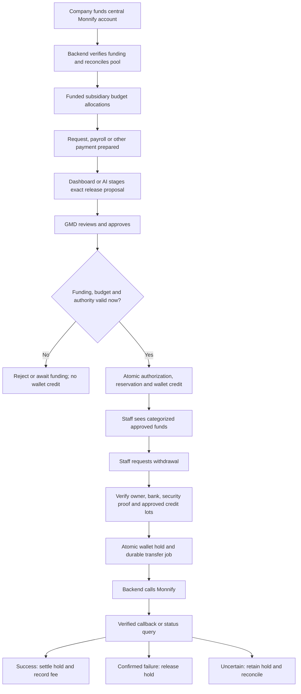
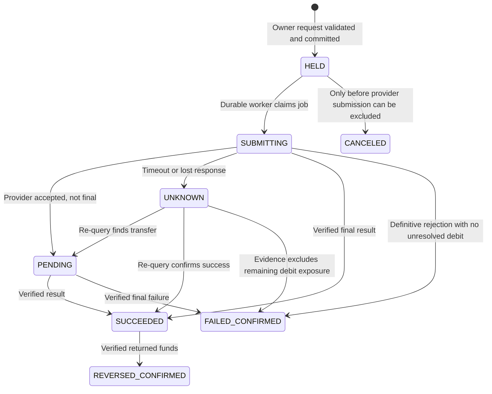

# BEMS — Monnify-funded staff wallets and subsidiary budget controls

**Version:** 2.0 — confirmed requirements and implementation specification  
**Date:** 7 November 2026, Africa/Lagos  
**Owners:** Project owner and implementation partner, working together  
**Status:** Confirmed requirements implemented in source; local regression and browser acceptance completed. Provider setup, live deployment and pilot remain separate. See [implementation status](WALLET-IMPLEMENTATION-STATUS.md).  
**Scope:** Web dashboard, staff portal, both Flutter applications, AI staging, backend, database, provider integration, accounting, migration and operations.

## 1. Purpose and how we will work together

BEMS will use one company-funded Monnify disbursement account. Every staff member will have an internal wallet recorded by BEMS. These are internal financial records, not individual Monnify wallets or reserved bank accounts.

GMD approval of a funded payment creates an immediately withdrawable staff entitlement. Staff may then withdraw to their bank account without seeking another business approval. BEMS tracks the subsidiary, category and original purpose of every amount throughout its life.

We are designing and implementing this together. The project owner's explicit decisions govern the product. This document distinguishes confirmed decisions from recommendations and unresolved choices. A recommendation is not silently promoted into a business rule. During implementation, maintain the decision log, show working increments, report verified results and limitations, and discuss material policy changes with the owner. Do not replace ongoing collaboration with a final handoff to an unseen implementer.

This specification extends the existing correction effort. It does not mean the broader security and architecture audit is complete. Existing fixes must be preserved, and old payment paths must be migrated deliberately.

## 2. Confirmed business decisions

| ID | Decision agreed with the owner | Consequence |
|---|---|---|
| BR01 | One funded company Monnify account | Subsidiary separation is internal; no per-subsidiary provider wallet is required. |
| BR02 | Every staff member has an internal wallet | Wallet creation itself creates zero money. |
| BR03 | Only GMD may approve disbursement | Super Admin, Admin, HR, staff, AI and background workers cannot grant payment approval. |
| BR04 | Approval immediately credits the staff wallet | Funding validation and reservation must succeed in the same local transaction as the release. |
| BR05 | No approval without sufficient Monnify-backed funds | Raw provider balance alone is insufficient because previously promised money remains in that account. |
| BR06 | Staff withdraw approved funds without another approval | Withdrawal authentication is not another GMD approval. |
| BR07 | No withdrawal without a GMD-approved source | The backend verifies provenance; an app-supplied approval flag has no authority. |
| BR08 | Salary, projects and other categories remain separate | Each credit retains its category, original payment and subsidiary attribution. |
| BR09 | Company pays withdrawal fees | Staff receive the full approved principal; fees need a separate company reserve. |
| BR10 | Combined subsidiary allocations cannot exceed funded capacity | The same money cannot back multiple subsidiary budgets. |
| BR11 | Staff credit consumes the relevant allocation | It is a movement inside that allocation, not an additional allocation of the same amount. |
| BR12 | Dashboard and AI use the same execution controls | AI stages detailed proposals; GMD approves a backend-generated exact preview. |
| BR13 | Approved leave retains staff portal access | Existing confirmed policy remains; suspension and termination deny ordinary access. Treatment of money owed after termination needs a dedicated process. |
| BR14 | AI is exclusively for GMD | Staff, HR and Super Admin have no AI access. Staff use their own portal/app wallet controls. |
| BR15 | GMD-approved vendors are paid directly | Verified vendor bank receives a direct Monnify transfer; no staff wallet is credited. |

“Only GMD approves” applies to release of money, including salary batches and emergency payments. Budget administration, payroll preparation and invoice checks do not constitute disbursement approval.

## 3. Terminology: do not overload “paid”

| Term | Meaning |
|---|---|
| Provider available balance | Funds Monnify currently reports usable, in the correct source account and currency. |
| Provider ledger balance | Provider accounting balance; do not assume it equals immediately usable funds. |
| Funded budget | A subsidiary spending envelope backed by the central pool. |
| Unallocated funding | Money not assigned to budgets, staff liabilities or reserves. |
| Payment authorization | GMD's immutable approval of exact recipient, amount, currency, source and purpose. |
| Wallet credit / release | Creation of a staff entitlement against that authorization. |
| Credit lot | One source-specific wallet credit, retaining its payment category and subsidiary. |
| Available wallet balance | Approved entitlement not already withdrawn, held or validly reversed. |
| Withdrawal hold | Entitlement reserved for one withdrawal; unavailable to another request. |
| Transfer | Actual request to Monnify to move money to a bank. |
| Bank settlement | Confirmed provider success, distinct from wallet credit. |
| Reconciliation | Matching provider evidence, local transfers, ledger and business sources. |

A wallet credit must never be labelled “Bank transfer successful.” An employee acknowledgment must never manufacture provider success. A provider response accepting a request is not necessarily final settlement.

## 4. Overall flow



There is no direct app-to-Monnify payout call. The app calls BEMS; only the trusted backend possesses provider credentials.

## 5. Money model and funding invariants

### 5.1 Exact arithmetic

Use integer kobo throughout financial domain operations. Store `BigInt` or constrained exact numeric values, never JavaScript floating-point amounts. API amounts are decimal strings of minor units, such as `"10000000"` for ₦100,000. Currency is explicit. Proposed first release is NGN; non-NGN sources must be rejected until a separate currency pool is implemented. Existing budget Float fields require reviewed migration, not silent rounding.

### 5.2 Funding is partitioned, not counted repeatedly

At a reconciled accounting point, use these non-overlapping components:

- **U:** unallocated usable company funds.
- **E:** remaining funded budget envelopes, including a GROUP envelope for legitimate central costs.
- **W:** staff approved liabilities not held for a transfer.
- **H:** withdrawal principal held locally and not yet reflected as a provider debit.
- **F:** company fee and operational buffer reserves not already reflected as provider debits.

The partition must fit within conservative usable provider backing. Pending transfers already deducted or held by Monnify need an explicit clearing representation: never blindly subtract them again while presenting the result as an exact balance. When evidence is incomplete, a conservative additional deduction may be used to block new commitments, labelled as a safety hold, until reconciliation resolves it.

For new budget allocation `x`, require `x <= U`. Increasing an existing budget uses only the incremental increase. For payment release `x` from an envelope, require `x <= that envelope's remaining eligible amount`, then move `x` from E to W. For withdrawal `x`, move W to H. Settlement removes the liability and the corresponding provider-backed cash; the fee consumes F. There is no new subsidiary budget charge on the subsequent withdrawal.

Every mutation also requires current health checks: no unresolved funding deficit, suitable provider evidence, permitted currency, correct organization, and no global freeze. An inactive envelope cannot fund new releases.

### 5.3 Example without fees, followed by fee treatment

| Event | Provider cash | Unallocated U | Remaining envelopes E | Wallet available W | Local pending H |
|---|---:|---:|---:|---:|---:|
| Fund central pool | ₦1,000,000 | ₦1,000,000 | ₦0 | ₦0 | ₦0 |
| Allocate A ₦600k and B ₦400k | ₦1,000,000 | ₦0 | ₦1,000,000 | ₦0 | ₦0 |
| GMD releases A project ₦100k | ₦1,000,000 | ₦0 | ₦900,000 | ₦100,000 | ₦0 |
| Staff requests ₦40k withdrawal | ₦1,000,000 | ₦0 | ₦900,000 | ₦60,000 | ₦40,000 |
| Provider settles ₦40k | ₦960,000 | ₦0 | ₦900,000 | ₦60,000 | ₦0 |

This example intentionally excludes fees. In production, part of the initial money must be assigned to F before allocations. Allocating every naira while promising company-paid fees is unsafe. Do not reduce a staff credit to pay those fees.

### 5.4 Budget hierarchy and time periods

Annual, quarterly, monthly, department and category budgets may overlap as planning views. They must not independently reserve the same backing. Separate unfunded planning drafts from funded spending envelopes. If the owner later permits a separate planning-only draft feature, a draft may describe a future target but must clearly say it is unfunded and cannot authorize release. This exception is not currently agreed and must not bypass the confirmed budget cap. Parent/child envelopes subdivide one allocation; their consolidated backing is counted once. Version budget changes, enforce sum of child allocations and prohibit reductions below outstanding commitments.

Budget remaining, released principal and bank cash paid need separate columns. “Spent” alone is ambiguous. Closing a period must preserve unpaid approved liabilities. Carry-forward, return of unused envelopes and expiry rules remain a joint policy decision; approved staff funds must not disappear automatically at period end.

### 5.5 Balance freshness and external interference

A database lock cannot reserve money inside Monnify. A live balance response can become stale if someone spends from the provider dashboard, another integration uses the same credentials, or provider charges occur. The honest guarantee is conditional on controlled external access, conservative accounting and reconciliation—not an impossible atomic transaction spanning two systems.

Proposed control: make BEMS the exclusive normal disbursement channel, restrict provider-dashboard access, track balance observations with timestamps, serialize local commitments per central pool, subtract local unreflected exposure, and freeze new releases when evidence is stale or inconsistent. Refresh live balance before budget increases and GMD releases. Recheck local version and evidence under the pool lock. Do not hold a long-running database transaction open during provider network calls. Conflicting refreshes or simultaneous approvals require retry/recalculation.

If the provider is unreachable, refuse new funded commitments rather than treating cached optimistic figures as cash. Existing withdrawals may proceed only where the configured health policy and verified backing permit; proposed safe initial behavior is to pause submissions when current funding cannot be established. Never erase existing entitlements to hide a deficit.

## 6. Roles and authority

| Operation | Staff | Scoped HR | Admin / Super Admin | GMD | AI / worker |
|---|---|---|---|---|---|
| Read own wallet | Own only | Own only; HR capability grants no wallet-wide read | Explicit authorized reporting | Authorized group reporting | Scoped reads only |
| Prepare payroll/payment | Own requests; otherwise permitted duties | Authorized subsidiary preparation | Authorized preparation | Yes | Stage within caller scope |
| Set funded budgets | No | No unless separately granted | Authorized budget admin, within backing | Yes | Stage; human confirms under applicable budget authority |
| Approve release / credit wallet | No | No | **No** | **Only current authenticated GMD** | **No** |
| Withdraw staff funds | Own approved available funds | Own funds as staff | No impersonated withdrawal | Own wallet policy unresolved | Execute an already authorized owner intent only |
| Invent or edit wallet balance | No | No | No | No | No |
| Pause withdrawals | No | Escalate | Proposed security capability | Yes | Automatic protective stop only |
| Undo historical transactions | No | No | No destructive editing | Controlled compensating flow | Execute recorded compensating instruction only |

Scoped HR is a capability on an actual STAFF identity; it is not a fourth approval role. Executives do not inherit another employee's withdrawal rights. Workers process durable jobs; that execution authority does not let them approve new value.

### 6.1 Protect the GMD identity

Require a current active, approved GMD identity at execution time, not just a role copied into an old token. Retain single-active-GMD enforcement. Financial authorization should also bind to a controlled GMD designation/security version so an ordinary role-edit endpoint cannot install a new financial approver.

Disable administrative impersonation, developer-role shortcuts and password-reset paths that let another account obtain GMD sessions. GMD succession, credential recovery and change of designation need an owner-agreed process outside ordinary role editing. GMD approval should use recent strong authentication. No hardcoded personal email or employee ID is a substitute for this controlled designation.

If there is no available GMD, payments wait. No emergency flag, policy tier, bulk route or administrator fallback may grant financial approval to another role.

## 7. Payment preparation and GMD release

### 7.1 Common release command

Every source produces the same canonical release instruction:

- Business source type and immutable source/version identifier.
- Staff beneficiary ID, exact amount and currency.
- Category, purpose, originating subsidiary and exact funded envelope/line.
- Payroll allocation references or project/request references as applicable.
- Current source financial snapshot and command version.
- Prepared-by identity, staging conversation, expiry and idempotency key.

An owner-provided beneficiary ID is validated against the actual source. Recipient selection must not silently default to request creator when the request's real payee is a vendor.

### 7.2 GMD approval transaction

1. Authenticate the human and verify current GMD designation, active/approved status and security proof.
2. Load the stored proposal; verify exact payload hash, source version, expiry and permissions. Never accept a replacement amount from the approval request.
3. Acquire deterministic locks on the funding pool, envelopes and source; recheck all constraints.
4. Verify conservative backing and fee reserve using valid balance evidence and local exposure.
5. Verify the source is eligible, unpaid through another path and not already released.
6. Create immutable authorization, balanced journal, credit lot, budget movement and audit record atomically.
7. Mark source `WALLET_CREDITED` or the chosen equivalent; do not mark bank-paid.
8. Queue notifications in the same transaction. A notification failure cannot undo or repeat the credit.
9. Return the committed result; repeated confirmation returns that same result.

Insufficient backing leaves the proposal unexecuted, with a precise funding shortfall. A new balance may require a refreshed preview, but no approval can be replayed to credit twice. Conditional database uniqueness is required in addition to application checks.

### 7.3 Payroll

HR prepares exact gross, deductions, employer costs and net amounts with subsidiary allocations. GMD approves an exact batch snapshot. Wallet credits are for approved net employee pay. Tax, pension and employer obligations remain separate company liabilities; do not credit the entire gross or employer cost to employee wallets.

Proposed initial behavior: release a batch atomically only if its full employee-net funding and applicable reserves are available. If partial batch release is required, it must be an explicit GMD-reviewed selection with separate source uniqueness, not an accidental half-completed batch. Salary reruns, supplemental payroll and late staff additions need explicit versioned sources.

Retire the existing HR clearing-account/lump-sum mechanism for new wallet payroll; otherwise both HR funding and staff credits could pay the same salary. Preserve historical clearing records as read-only history.

### 7.4 Project funds, reimbursement and allowances

Create separate credit lots even for the same employee and day. Preserve project/request purpose, entity attribution, evidence requirements and deadlines. A withdrawal must allocate exact amounts to selected lots; selection order and user choices must be visible. Reimbursements for already-incurred costs should not acquire a project-advance evidence obligation by accident.

The owner confirmed direct vendor payment: GMD approves the server-computed vendor invoice/accepted-delivery proposal, then the worker pays the immutable verified vendor account from the central Monnify source. Staff receive no vendor wallet credit. Failure/reversal restores the original budget once and a new attempt requires fresh GMD approval. Contractor, statutory and refund flows outside the existing vendor/request models still require an explicit destination policy; they must never silently become staff entitlement.

## 8. Staff withdrawal and direct API protection

### 8.1 What the endpoint accepts

The withdrawal request accepts an amount, currency, selected credit lots or disclosed allocation choice, a stored verified beneficiary account ID/version, a recent single-use security challenge, and an idempotency key. It does not accept an authoritative wallet balance, arbitrary employee ID, arbitrary provider source account, fake approval flag, provider transfer URL or unrestricted destination bank details.

The backend derives the employee from the actual authenticated session. A URL or JSON value cannot change the owner. Admin sessions, AI service tokens and signed callbacks cannot impersonate the owner.

### 8.2 Required checks on every request

- Session valid now; actor eligible; wallet belongs to actor and is not frozen.
- Required recent security proof is valid, transaction-bound and not reused.
- Amount is a positive integer within configured limits and available source lots.
- Every selected lot traces to an executed GMD authorization and eligible source.
- No lot is held, reversed, duplicated, canceled or already withdrawn beyond its remaining amount.
- Bank account belongs to this staff profile, is provider-verified and matches the reviewed version.
- Request currency matches pool and lots; company fee capacity exists.
- Rate limits and session/browser request protections pass.
- Global, employee and account security pauses are respected.

Within one local transaction, lock wallet/lots, conditionally reserve the principal and fee exposure, consume the challenge, create the withdrawal and allocations, and enqueue one transfer job. A second simultaneous request sees the reduced available amount. Never check a balance, release the lock and later deduct in a separate transaction.

### 8.3 Identity and bank security

Name enquiry confirms bank routing/name; it does not alone prove that the account belongs to the employee. Proposed initial policy: withdrawals only to an independently verified employee-owned account. Identity/name mismatch handling, bank-change cooling-off, withdrawal PIN/OTP/biometric step-up and daily limits require joint decisions.

Store bank codes returned by supported-bank lookup, not fuzzy bank-name guesses. Account numbers are strings with exactly ten digits for the Nigerian NUBAN scope. Encrypt sensitive fields where required, mask ordinary displays, and prohibit provider secrets, withdrawal PINs or OTPs in AI context and logs. A phone's local biometric unlock alone does not prove server-side transaction authorization.

A changed bank account does not change GMD's approved entitlement. It must invalidate open withdrawal previews/challenges and cannot alter the snapshotted destination of an already-submitted transfer. The provider transfer always uses the immutable destination snapshot stored with that withdrawal.

### 8.4 Company-paid fees and partial withdrawals

Staff receive their full chosen principal. Record actual fees separately as company expense with an agreed entity attribution. Fee estimates must be configurable and verified against the merchant arrangement; do not invent a tariff. Partial withdrawals can create many fees, so minimum amounts, daily counts and reserve strategy need explicit agreement. Fee shortage blocks submission with a company-funding message; it must not quietly deduct from salary.

## 9. Withdrawal state machine and crash recovery



Internal statuses are proposed domain names, not assumed Monnify API strings. Unknown provider values map to unresolved review, never success or released funds by default.

| Situation | Required behavior |
|---|---|
| Client taps twice or retries after timeout | Same idempotency key returns same withdrawal; changed body under same key conflicts. |
| Crash before local commit | No withdrawal job exists and no provider transfer is called. |
| Crash after commit, before submission | Worker resumes the durable job. |
| Provider receives transfer but response is lost | Keep hold; query stable reference; never create a fresh payout blindly. |
| Worker lease expires while request is in flight | Another worker reconciles the same reference; lease fencing prevents unsafe concurrent submission. |
| Callback arrives before HTTP response | Match stored withdrawal reference and finalize once; late response cannot regress state. |
| Provider returns pending/authorization-required | Keep hold and disclose pending status. |
| Confirmed failure | Release principal once; separately reconcile any provider fee/debit. |
| Success followed by genuine reversal | Post a separate reversal journal only after returned backing is established; preserve original success history. |
| Conflicting success/failure notifications | Quarantine and query authoritative transfer evidence; do not free money based on event order. |
| Withdrawal canceled after possible submission | Do not promise cancellation or release funds until submission/debit uncertainty is resolved. |

Use a stable unique merchant reference for each submitted transfer intent, retain the provider transaction reference when supplied, and persist attempt history. Exactly-once delivery across a network is not guaranteed; idempotent accounting, provider-reference reconciliation and conservative recovery provide the protection.

## 10. Monnify integration: verified facts and deployment dependencies

The following short provider summaries were checked on 7 November 2026. Everything else in this document is the proposed BEMS design, not a claim that Monnify implements our internal wallet rules.

### 10.1 Transfers and balance

Monnify documents disbursement enablement, static-IP whitelisting, recipient name enquiry, transfer submission, balance enquiry and final-status checks. Its balance example distinguishes available and ledger balances. MFA is enabled by default and can leave transfers awaiting an email OTP; programmatic operation without that OTP requires an arrangement with Monnify. Source: [Single Transfers](https://developers.monnify.com/docs/disbursements/single-transfers).

**Integration decision:** staff withdrawals cannot depend on GMD entering a company OTP each time if we are to meet the agreed experience. Confirm the approved merchant setup before activation. Do not disable provider protections casually or describe this dependency as already resolved.

Keep provider-specific details behind an adapter: authenticate, list banks, validate beneficiary, read disbursement balance, initiate transfer, query transfer and normalize results. Existing `src/lib/monnify.ts` implements authentication/name enquiry, not this entire wallet lifecycle. A generic customer-wallet balance endpoint must not be confused with the company's disbursement source balance.

Initial verified path: `GET /api/v2/disbursements/wallet-balance?accountNumber=...`. Existing auth/name-enquiry paths are present in source. Resolve exact initiation/query API schemas from the current official reference and merchant sandbox during implementation; no guessed payout path is an approved contract.

### 10.2 Event callbacks

Monnify documents disbursement success, failure and reversal events, plus wallet activity notifications. Its webhook overview specifies HMAC-SHA512 on the body, while a later event-types passage describes a different SHA-512 construction; the same page also contains the HMAC description. Treat this inconsistency as a contract-verification task. Production must accept only the confirmed signature protocol; no unsigned or “try every algorithm” fallback. Sandbox handling is isolated because the documentation says sandbox notifications lack the production signature. Sources: [Webhooks](https://developers.monnify.com/docs/webhooks), [Event types](https://developers.monnify.com/docs/webhooks/event-types).

Verify raw bytes before parsing or transforming them. Apply constant-time signature comparison, payload-size limits, configured trusted network controls, durable deduplication and exact reference/amount/currency/account matching. Persist valid events before acknowledgment, then process asynchronously. Unsigned sandbox events must never credit a production ledger; use provider re-query for value-changing sandbox evidence where needed.

### 10.3 Optional transaction-validation callback

Monnify offers a separate optional pre-transfer validation callback with HMAC-SHA256 and reference-based signing. Its documented explicit rejection can currently cause an account debit restriction requiring support intervention. This is not the ordinary completion webhook. Source: [Transaction Validation](https://developers.monnify.com/docs/disbursements/transaction-validation).

**Recommendation, not yet enabled:** evaluate this as an extra defense after sandbox/support confirmation. If adopted, approve only a matching existing held withdrawal backed by GMD-authorized lots. Inspect the exact amount/destination against stored intent; a valid signature alone is insufficient. Its reference-based signature does not cryptographically bind every payload field or the timestamp, so track intent state and obtain independent provider evidence for discrepancies. It must never become a second discretionary business approval or a way to create wallet funds. Confirm replay/retry and account-restriction behavior before enabling.

### 10.4 Runtime configuration

Proposed validated settings include environment, API key/secret, merchant code where required, source account number, allowed currency, trusted outbound/network configuration, provider timeouts, balance freshness, feature flags, fee policy and operational pauses. These names are configuration design, not a claim that every field is required by every Monnify endpoint.

Secrets remain server-only, absent from Flutter builds, browser JavaScript, AI prompts, audit metadata and screenshots. Sandbox and live credentials, source accounts, job queues and webhook environments must be isolated. No default live URL should cause accidental real transfers in a test run.

## 11. Ledger and proposed data model

Use an immutable balanced journal for money movements, plus a separately reconcilable budget allocation ledger. Do not mistake management envelopes for statutory accounting expense accounts. Final chart-of-accounts treatment should be reviewed with the company's finance owner. Every posted monetary journal balances per currency; only server-side domain services may post.

| Proposed record | Essential fields and guarantees |
|---|---|
| FundingPool | Single active NGN source, provider environment, source identity, version and health state. |
| ProviderBalanceObservation | Available/ledger minor units, observedAt, request/evidence ID, environment and reconciliation watermark. No user-supplied balance. |
| LedgerAccount | Type, currency, employee/entity ownership where appropriate; unique account identity. |
| JournalTransaction / JournalEntry | Business reference, immutable balanced entries, occurred/posted time, reversal link and idempotency. |
| BudgetEnvelope / BudgetMovement | Funded allocation, hierarchy, period, subsidiary/line, immutable movements and remaining projection. |
| PaymentAuthorization | GMD designation/version, human identity, source/version, exact payload hash, amount/currency and approval time. |
| StaffWallet | Unique employee/currency, active/frozen state; creation has zero value. |
| WalletCreditLot | Authorization, source identity, category, original subsidiary, amount and remaining/held projections. No arbitrary admin top-up. |
| Withdrawal | Owner, principal, reference, state, beneficiary snapshot/version, challenge proof reference, fee exposure and timestamps. |
| WithdrawalAllocation | Exact lot amounts; sum equals withdrawal principal. |
| ProviderTransferAttempt | Withdrawal, attempt/fencing ID, merchant/provider references, redacted result and uncertain outcome. |
| ProviderEventInbox | Deduplication identity, verified body hash, retained protected payload, received/processed state and error. |
| ReconciliationRun / Exception | Provider cutoff, compared totals, discrepancies, severity and resolution evidence. |
| SecurityChallenge / FinancialDesignation | Hashed proof, single-use limits, transaction binding, expiry; controlled active GMD designation. |

Use foreign keys for provenance, uniqueness on released source portions and merchant references, positive amounts, nonnegative projections, currency consistency and guarded state transitions. Cross-row balancing requires transaction/service validation plus database-enforced posting controls where feasible; a simple row CHECK cannot enforce an entire journal sum.

Cached balances are projections, updated atomically and rebuildable from the journal. A ledger defect cannot be “fixed” by editing a cached total. Use documented compensating entries. Database operators with unrestricted write access remain privileged; restrict production access, capture external audit evidence and never promise application controls can defeat a malicious database superuser.

## 12. Accounting lifecycle and business history

| Event | Wallet effect | Budget effect | Bank cash effect |
|---|---|---|---|
| Budget allocation | None | Reserve unallocated capacity | None |
| GMD release | Create approved lot | Consume remaining envelope; increase released amount | None |
| Withdrawal request | Available to held | None | None until provider action |
| Successful transfer | Settle held liability | No second principal charge | Decrease principal and actual fee |
| Confirmed failure | Held back to available | None | Reconcile any fee separately |
| Approved cancellation of unused credit | Compensating reduction only if policy permits | Restore relevant capacity if justified | None |
| Transfer reversal | Restore entitlement after verified return | Preserve original attribution | Increase backing according to evidence |
| Project funds returned | Separate verified return workflow | Policy-controlled recovery | Depends on actual returned funds |

Do not automatically revoke salary owed when an employee is terminated. Do not infer that a company deposit cancels an employee's project advance. Funding receipts, payroll liabilities and returned project funds are different event types.

Accountability needs an owner-approved starting point: wallet credit, first withdrawal or each relevant installment. Proposed default for project advances is tracking actual withdrawn project principal separately from unused approved funds, with an explicit deadline policy. Preserve current deadlines until that decision is made; do not silently change historical cases.

## 13. Implemented backend API contracts

Routes use canonical wallet services. All human mutations reject delegated/service identities, verify current accounts and enforce browser-origin or native-session controls. The route registry is checked against physical handlers.

| Route | Purpose and boundary |
|---|---|
| GET `/api/wallet/me` | Own staff balances, latest 100 credits/withdrawals, masked verified bank. Aggregate totals cover the full ledger. |
| GET `/api/wallet/banks`; POST `/api/wallet/bank` | Supported codes and password-authenticated own bank enquiry/versioning. |
| POST `/api/wallet/challenges` | One-use session-bound proof for an exact release, withdrawal, project return or pool operation. |
| POST `/api/wallet/withdrawal-plan` | Server-selected own approved lot allocations for a combined amount; no money moves. |
| POST `/api/wallet/withdrawals`; POST `/api/wallet/withdrawals/[id]/cancel` | Exact atomic hold and durable transfer; owner cancellation only before submission. |
| POST `/api/wallet/project-returns` | Voluntary unused project/request return; no salary clawback. |
| GET `/api/wallet/funding`; POST `/api/wallet/funding/refresh` | Executive backing partitions, sources, proposals, exceptions and latest transfers; provider observation refresh. |
| POST `/api/wallet/envelopes`; PATCH `/api/wallet/envelopes/[id]` | Funded budget creation/subdivision and versioned change. |
| POST `/api/wallet/releases`; GET `/api/wallet/releases/[id]` | Stage server-loaded request/vendor/whole-payroll proposal and view exact stored preview. |
| POST `/api/wallet/releases/[id]/approve` | Current designated human GMD, exact hash and recent proof; atomically credits staff or queues direct vendor intent. |
| POST `/api/wallet/vendors/[id]/verify-bank` | Executive password-authenticated verified vendor destination; not payment approval. |
| POST `/api/wallet/pool-control` | Executive pause; designated GMD strong-authenticated activation only after backing/reconciliation checks. |
| POST `/api/wallet/reconcile`; POST `/api/wallet/issues/[id]/ack` | Provider-history reconciliation; narrowly restricted GMD setup/fee correction acknowledgment. |
| GET/POST `/api/ai/tools/wallet` | GMD-only scoped read and proposal staging. Human approval is separate. |
| POST `/api/webhooks/monnify` | Signed durable inbox; authenticated query determines money effects. |
| POST `/api/webhooks/monnify/validate-transfer` | Optional distinct protocol, disabled by default; never creates authorization. |


Return structured codes: `GMD_REQUIRED`, `NO_APPROVED_FUNDS`, `INSUFFICIENT_WALLET_BALANCE`, `INSUFFICIENT_FUNDED_CAPACITY`, `BUDGET_EXCEEDED`, `BALANCE_STALE`, `FUNDING_RECONCILIATION_REQUIRED`, `BANK_VERIFICATION_REQUIRED`, `BANK_VERSION_CHANGED`, `CHALLENGE_INVALID`, `IDEMPOTENCY_CONFLICT`, `WALLET_FROZEN`, `TRANSFER_PENDING`, `PROVIDER_UNAVAILABLE` and `CURRENCY_NOT_SUPPORTED`. Do not expose provider credentials or raw sensitive errors.

### 13.1 Example withdrawal request

```json
{
  "amountMinor": "6000000",
  "currency": "NGN",
  "beneficiaryAccountId": "stored-owner-account-id",
  "beneficiaryVersion": 3,
  "creditAllocations": [{"creditLotId": "approved-project-lot-id", "amountMinor": "6000000"}],
  "challengeId": "single-use-transaction-challenge",
  "challengeProof": "submitted-securely-not-logged"
}
```

Send an `Idempotency-Key` header. For cookie sessions, require appropriate origin/CSRF protection and secure session cookies. Native bearer sessions need equivalent server authorization, short-lived challenge checks and secure token storage. Transport authentication and business authorization are separate checks.

## 14. Dashboard, mobile and AI experiences

### Staff wallet

Show available approved funds, pending withdrawals, categorized balances and source-linked history. A wallet with no approval shows ₦0 withdrawable and explains why. Withdrawal review shows principal, company-paid fee treatment, destination masked account, selected sources and remaining balance. Pending and uncertain transfers have visible status and a support reference; no misleading success animation.

Keep separate bank-profile verification and secure withdrawal confirmation. Leave preserves own portal access. Suspended/terminated access and any payment owed need the dedicated resolution policy in section 20.

### GMD dashboard and chatbot

Show central provider balance with timestamp, conservative available capacity, budget partitions, approved liabilities, fee reserve, pending transfers and reconciliation alerts. A release card shows recipient, source, subsidiary, category, exact amount, budget remaining after approval and funding-health state. Only current GMD sees an enabled release-approval control; the backend still enforces it when a caller bypasses the screen.

### Admin and HR

Admin may administer funded budgets under assigned rights but cannot release funds or create withdrawable balance adjustments. HR prepares payroll within subsidiary scope and sees necessary status, not unrestricted staff wallet transactions. Reports distinguish payroll approved, wallet credited, withdrawn, bank-settled and reversed. No “pay through clearing account” action for new wallet-mode payroll.

### AI parity

AI may explain balances, prepare payroll, stage budget changes and releases, inspect status within scope and explain reconciliation exceptions. It cannot approve releases, issue secrets, alter posted journals or treat a model-generated message as human consent. A GMD chatbot button submits the stored proposal and exact hash through the same command service as the dashboard.

AI is exclusively for GMD. Staff, HR and Super Admin cannot use chat, memory, AI tools or signed AI delegation. Staff withdrawals use their portal or mobile wallet directly, with secure transaction confirmation outside chat. The AI cannot call an unrestricted transfer endpoint using the company token. All GMD tool results remain scoped/redacted; financial capability does not inherit from a workspace label.

## 15. Existing project impact: verified files to change or inspect

Paths are relative to the project root. These paths existed when this document was prepared. Each row specifies the necessary change or the precise review needed; implementation may discover further callers through dependency searches. This is a planning inventory, not a claim that every file has already changed.

| Existing file or group | Required work |
|---|---|
| `prisma/schema.prisma`; `prisma/migrations/` | Add wallet/authorization/ledger/transfer/inbox structures, constraints, exact budget amounts and reviewed migration/backfill. |
| `src/lib/monnify.ts` | Expand into bounded server adapter; replace routing guesses in payout path; explicit environment, timeouts, safe errors and verified provider responses. |
| `src/lib/staged-actions.ts` | Separate monetary release from recording external evidence; GMD-only gate, exact proposals, shared services, source uniqueness and command version changes. |
| `src/lib/platform/command-catalog.ts` | Add wallet/release commands, current-GMD approver requirements and validation. Remove Super Admin financial approval eligibility. |
| `src/lib/platform/command-targets.ts` | Snapshot exact payment sources, allocations, envelopes and security-relevant versions. |
| `src/lib/platform/actor-scope.ts`; `src/lib/ai-tools-auth.ts`; `src/lib/auth.ts` | Current authority, owner identity, financial designation and delegation boundaries. |
| `src/lib/platform/read-catalog.ts`; `src/lib/platform/scoped-database.ts` | Scope new models/relations and redact banking/security/provider fields. |
| `src/lib/platform/api-route-inventory.ts`; `src/lib/ai-access-control.ts` | Declare new endpoints/capabilities; avoid automatic permission inheritance. |
| `src/lib/employee-lifecycle.ts` | Protect GMD designation/recovery changes; preserve wallet obligations through status changes. |
| `src/lib/services/payment.ts` | Keep real historical/external transfer recording separate from new provider submission; prevent dual payment of one source. |
| `src/lib/services/payroll-snapshot.ts` | Exact financial source snapshot; align release and changed-bank behavior with wallet model. |
| `src/lib/services/budget-read.ts`; `src/lib/financial-metrics.ts` | Funded capacity, correct entity/currency and distinct liabilities/cash reporting. |
| `src/lib/services/delivery-outbox.ts`; `scripts/process-outbox.ts` | Retain notification outbox; use a dedicated transfer job type/service with payout-specific recovery, not an email retry loop. |
| `src/lib/services/accountability-deadline.ts` | Apply jointly chosen wallet/project accountability trigger without changing historical evidence. |
| `src/app/api/budgets/route.ts`; `src/app/api/budgets/[id]/route.ts` | Exact incremental funded allocation checks, hierarchy, reductions and archive behavior. |
| `src/app/api/treasury/route.ts` | Separate provider-backed source from manually recorded bank accounts; no editable fake Monnify balance. |
| `src/app/api/approvals/decide/route.ts`; `src/app/api/requests/[requestNumber]/action/route.ts` | GMD-only release; clarify request business states and retire bypasses. |
| `src/app/api/approvals/route.ts`; `src/app/api/policies/route.ts` | Approval list/read states; prohibit policies that delegate disbursement approval away from GMD. |
| `src/app/api/disbursements/record/route.ts`; `src/app/api/payroll/record/route.ts` | Legacy recording restrictions, source exclusivity and wallet-mode cutover. |
| `src/app/api/disbursements/route.ts`; `src/app/api/staff/disbursements/route.ts` | Read models distinguish wallet releases from actual bank settlements. |
| `src/app/api/disbursements/confirm/route.ts`; `src/app/api/disbursements/verify/route.ts` | Staff acknowledgment/evidence cannot create provider settlement or duplicate credits. |
| `src/app/api/disbursements/assignees/route.ts`; `src/app/api/payroll/assignees/route.ts` | Assignee roles must not grant release authority; retire obsolete executor concepts where required. |
| `src/app/api/payroll/prepare/route.ts`; `src/app/api/payroll/route.ts` | Prepare only, exact funding source and controlled batch release. |
| `src/app/api/payroll/items/[itemId]/route.ts`; `src/app/api/payroll/summary/route.ts`; `src/app/api/payroll/my-payments/route.ts` | Prevent editing released sources; show wallet versus settlement status and historical data. |
| `src/app/api/requests/create/route.ts`; `src/app/api/requests/route.ts`; `src/app/api/requests/[requestNumber]/route.ts` | Payment-source eligibility, budget relationships and accurate public states. |
| `src/app/api/staff/[employeeId]/banking/route.ts`; `src/app/api/staff/profile/submit-update/route.ts`; `src/app/api/staff/profile/pending-update/route.ts` | Shared bank verification/versioning, target protection and withdrawal challenge invalidation; review all profile update alternatives. |
| `src/app/api/banking/banks/route.ts`; `src/app/api/banking/verify-account/route.ts` | Live supported bank identity and bounded name enquiry, not client-asserted verification. |
| `src/app/api/auth/login/route.ts`; `src/app/api/auth/reset-password/route.ts`; `src/app/api/auth/magic-link/route.ts`; `src/app/api/auth/dev-role/route.ts` | Protect financial approver identity and owner transaction authentication; no privileged shortcut. |
| `src/app/api/ai/staged-actions/[id]/confirm/route.ts`; `[id]/retry-effects/route.ts` | Confirm exact human authority; retry cannot repeat release or submit another payout. |
| `src/app/api/ai/staged-actions/approval-decision/route.ts`; `budget/route.ts`; `payment-record/route.ts`; `payment-recorder/route.ts` | Stage correct new semantics, no direct financial execution via tool aliases. |
| `src/app/api/ai/tools/approvals/route.ts`; `payroll/route.ts`; `budgets/route.ts`; `bank-accounts/route.ts`; `requests/route.ts` | Wallet-aware scoped reads/staging; no provider secrets or broad owner withdrawal tools. |
| `src/app/api/webhooks/slack/route.ts`; `src/app/api/webhooks/whatsapp/route.ts` | Preserve authenticated human confirmation links; never grant financial approval via chat-provider callback. |
| `src/app/finance/page.tsx`; `src/app/staff/page.tsx`; `src/app/budgets/BudgetsClient.tsx`; `src/app/disbursements/DisbursementsClient.tsx` | Integrate real wallet/funding states, correct role controls and legacy history. |
| `src/components/dashboard/gmd/ApprovalsDeskView.tsx`; `ApprovalsHubView.tsx`; `ApprovalMatrixView.tsx`; `PayrollSignOffView.tsx` | GMD-only release, batch preview and no misleading delegated approval policies. |
| `src/components/dashboard/gmd/TreasuryAccountsView.tsx`; `TreasuryFinanceHubView.tsx`; `DisbursementsDeskView.tsx` | Provider balance freshness, partitioned capacity, transfers, fees and reconciliation. |
| `src/components/dashboard/staff/StaffPortalContainer.tsx`; `StaffDashboardClient.tsx`; `StaffWorkspaceModule.tsx`; `src/components/staff/StaffDashboardView.tsx`; `StaffAppShell.tsx` | Own wallet navigation, history, secure withdrawal and pending status. |
| `src/components/ai/cards/ApprovalDecisionCard.tsx`; `BudgetProposalCard.tsx`; `DisbursementRecordCard.tsx`; `src/components/ai/useAiFinancialManager.ts` | Exact wallet-release previews; actual funding checks and separate settlement evidence. |
| `bems_staff_app/lib/services/staff_api_service.dart`; `models/staff_models.dart`; `screens/staff_main_screen.dart`; `screens/modules/staff_module_workstation_screen.dart` | Typed wallet API, navigation, safe confirmation and replay-resistant client UX. |
| `bems_staff_app/lib/services/staff_storage_service.dart`; `staff_biometric_service.dart` | Secure credentials and transaction-bound authentication; do not cache authoritative balances or PINs in plain storage. |
| `bems_gmd_ai/lib/services/api_service.dart`; `screens/payroll_signoff_screen.dart`; `screens/executive_chat_screen.dart`; `models/auth_models.dart` | Current-GMD release, exact mobile preview and no approval rights from stale local role. |
| `scripts/regression-security.ts`; `regression-database.ts`; `regression-scoped-reads.ts`; `verify-platform-architecture.ts` | New behavior and adversarial transaction coverage; inventory alone is insufficient. |
| `.env.example`; `package.json`; `.github/workflows/deploy.yml`; `docs/CORRECTIONS-2026-11-07.md` | Safe config, dedicated worker scripts, isolated CI and honest implementation status. |

### 15.1 Proposed new files

Names may be refined during implementation, but responsibilities must remain explicit:

- `src/lib/services/wallet-ledger.ts` — balanced posting and projections.
- `src/lib/services/funding-pool.ts` — provider observations, partitions, health and locks.
- `src/lib/services/funded-budgets.ts` — exact funded envelope movements.
- `src/lib/services/payment-release.ts` — current-GMD authorization and source-specific credit.
- `src/lib/services/wallet-withdrawal.ts` — owner validation, source allocations and holds.
- `src/lib/services/monnify-transfers.ts` — adapter orchestration and provider result normalization.
- `src/lib/services/financial-reconciliation.ts` — exceptions, settlement and clearing.
- `src/lib/security/financial-authorization.ts` — GMD designation and step-up guards.
- `src/lib/security/withdrawal-challenge.ts` — transaction-bound owner proof.
- `src/app/api/wallet/…/route.ts` and provider callbacks listed in section 13.
- `src/components/wallet/…` — own balances, history, confirmation and pending views.
- `bems_staff_app/lib/screens/wallet/…` and typed wallet models.
- `scripts/process-wallet-transfers.ts`; `scripts/reconcile-wallet-transfers.ts`.
- `scripts/regression-wallet-ledger.ts`; `regression-wallet-authorization.ts`; `regression-wallet-concurrency.ts`; `regression-monnify-contract.ts`.
- New forward-only migrations with documented backfill and validation scripts.

## 16. Security threats and concrete controls

| Threat | Control and required evidence |
|---|---|
| Staff calls withdrawal API without any approval | No eligible authorized lot; deny with zero journal/transfer side effects. |
| Staff changes employee or wallet ID | Derive identity from session; test ID substitution on reads and writes. |
| Staff supplies `approved: true`, balance or provider reference | Ignore/reject unsupported fields; server-owned provenance only. |
| Super Admin calls GMD approval endpoint | Deny even with otherwise valid admin permissions and proposal. |
| Compromised AI tries to approve or call provider | No approval capability or exposed provider credential; human GMD boundary. |
| Two releases spend the same funding | Pool/envelope lock, serializable or conditional writes, uniqueness and retry. |
| Two withdrawals spend the same lot | Atomic row locks/conditional hold; one cannot overdraw. |
| Same salary paid through old and new endpoints | Shared source payment-mode/exclusivity constraint; legacy bypass tests. |
| Repeated webhook credits twice | Durable deduplication plus terminal journal uniqueness. |
| False callback marks transfer failed and frees funds | Verified evidence, state machine, exact match and authoritative reconciliation. |
| Wrong bank code from fuzzy name | Stored live-supported code and verified beneficiary snapshot. |
| Bank changes during submission | Immutable destination and version-bound security proof. |
| Privileged user creates arbitrary “adjustment” | No unrestricted positive adjustment API; compensations require original source and permitted authorization. |
| Worker retries a timed-out payout under new reference | Stable reference and uncertain-state reconciliation. |
| Manipulated budget hierarchy duplicates backing | One funded envelope tree, aggregate constraints and overlap tests. |
| Provider account manually drained | Restricted external access, freshness/exposure checks and immediate funding-deficit pause. |
| Logs expose bank/OTP/secrets | Masked structured logs, protected evidence storage, redaction tests. |
| Restored database resubmits old transfers | Workers start paused; reconcile provider references since backup before processing. |

## 17. Acceptance and regression test plan

All tests below are planned wallet tests. Existing passing project tests do not prove this new feature exists. Use isolated databases and provider mocks first; sandbox contract tests second; a separately approved controlled live pilot last.

### Funding and budgets

1. No funding: funded budget creation fails, while clearly unfunded planning draft behavior follows policy.
2. Combined subsidiaries cannot allocate beyond the same central capacity.
3. Concurrent budget increases cannot both consume the same last funds.
4. Updating one budget checks only its delta and preserves commitments.
5. Annual/monthly parent-child envelopes do not double-reserve backing.
6. Budget archive/reduction cannot erase existing approved liabilities.
7. Staff release moves envelope capacity into wallet liability exactly once.
8. Unknown/stale balance and provider outage fail closed for new commitments.
9. External provider debit produces a visible deficit and protective stop.
10. Fee reserve is deducted from allocatable capacity; unsupported currency is rejected.

### Approval and provenance

11. Active GMD can approve an eligible exact release.
12. Staff, HR, Super Admin and service tokens cannot approve by direct API call.
13. Inactive, removed, stale-session or superseded GMD cannot approve.
14. Changed proposal amount/recipient/source/version fails confirmation.
15. Repeated and simultaneous approval creates one authorization/credit only.
16. Insufficient budget or central backing creates no partial credit or audit-only success.
17. Old approval policy, emergency path and bulk endpoint cannot bypass GMD-only release.
18. Administrative role editing and credential recovery cannot install an unauthorized financial approver.
19. Dashboard and AI execute the same release service with the same results.
20. Previously paid legacy sources cannot be released again.

### Wallet ownership and withdrawals

21. Zero approved funds denies withdrawal even when provider account has money.
22. Edited wallet ID, employee ID, available balance or approval flag has no effect.
23. Another employee's credit/account/withdrawal is inaccessible.
24. Two withdrawals cannot overdraw one lot; available/held totals reconcile.
25. Idempotent replay returns same withdrawal; different body with same key conflicts.
26. Transaction challenge is single-use, expires and binds amount/bank/lot selection.
27. Invalid decimal, negative, zero, oversized and wrong-currency amounts reject.
28. Unverified, changed, frozen or another employee's bank destination rejects.
29. Company fee never reduces staff principal.
30. Partial withdrawal retains source categories and exact remaining amounts.
31. Leave access follows the agreed policy; suspension/termination cannot bypass session denial.
32. Rate limits and browser request protections cannot be bypassed with a forged identity/header.

### Provider and recovery

33. Local rollback cannot enqueue or submit a transfer.
34. Crash after hold commit resumes without losing entitlement.
35. Timeout after provider acceptance retains hold and re-queries same reference.
36. Concurrent workers and lease expiry cannot create a second payout.
37. Callback arriving before HTTP response settles once.
38. Repeated success/failure/reversal notifications have idempotent financial effects.
39. Forged signature, altered bytes, wrong source/amount/currency/account and wrong environment cannot change money.
40. Unknown statuses remain unresolved and cannot free funds.
41. Confirmed failure restores principal once; actual fee treatment remains reconcilable.
42. Success followed by verified reversal posts separate history and restored backing exactly once.
43. Callback outage followed by status polling reaches the correct result.
44. Pending company OTP is displayed honestly; unattended flow is tested against merchant setup.
45. Backup restore starts workers paused and prevents re-submission of already-paid references.

### Payroll, UI and AI

46. Exact net salary credits reconcile to selected approved batch, not gross or employer cost.
47. Atomic batch release rolls back fully when any selected item is invalid or unfunded.
48. Supplemental payroll has distinct authorized source; rerun cannot duplicate original salary.
49. Historic HR clearing payments remain visible and excluded from wallet re-credit.
50. Mobile and browser show credited, pending, settled and reversed states accurately.
51. Logout/account switch clears private wallet views; late responses cannot populate the next account.
52. Staff, HR and Super Admin AI requests are denied; GMD subsidiary-scoped reads do not widen their signed scope.
53. AI-generated text cannot impersonate approval, security proof or provider evidence.
54. Accounting entries balance per currency and projections rebuild to identical totals.
55. Project accountability follows the agreed trigger and source allocation, not a generic salary rule.
56. Provider sandbox/live tests never share accounts, secrets or value-changing event paths.

Required evidence for each milestone: tested behavior, source diff, migration status, outstanding decisions and limitations. Browser screenshots demonstrate role UX; they do not replace adversarial API tests.

## 18. Implementation sequence and review points

| Phase | Deliverable | Exit condition |
|---|---|---|
| 0 — joint design | This specification, decision log, provider setup answers and legacy inventory | Owner reviews open policies; no silent business assumptions. |
| 1 — financial foundation | Exact-money migrations, ledger, pool, envelopes, source uniqueness and read-only reconciliation | Invariants/concurrency tests pass on isolated DB; no live payouts. |
| 2 — GMD release | Controlled designation, exact dashboard/AI preview, approval and credit lots | All non-GMD direct-API tests deny; funding races cannot overcommit. |
| 3 — withdrawal | Verified bank versions, secure challenges, atomic holds and durable transfer jobs | Owner/lot/security tests pass with provider mocks. |
| 4 — provider lifecycle | Monnify adapter, inbox, query/recovery worker and fee reconciliation | Sandbox contract and crash/replay tests pass; merchant OTP/network setup resolved. |
| 5 — payment source parity | Requests, salary, projects, reimbursements, allowances; legacy restrictions | Each source releases once and every dashboard/AI path uses canonical services. |
| 6 — interfaces | Staff web/mobile wallet, GMD funding/approval and admin/HR views | Per-role browser and device acceptance; no secret leakage or fake success. |
| 7 — controlled rollout | Reviewed opening reconciliation, production configuration and limited pilot | Explicit live go-ahead, verified small transfer, balanced reconciliation and support procedure. |

Integrate tests throughout rather than postponing them to the end. Each phase is reviewable together. Implementation completion is not production authorization. Do not publish apps, send real transfers or change provider security configuration without the corresponding agreed rollout action.

## 19. Migration, cutover and operations

### Existing-data migration

Inventory every approved/unpaid request, payroll item, historical external disbursement, pending proposal, budget and HR clearing transfer. Classify paid, unpaid, disputed and unknown sources. Never bulk-credit staff based solely on `APPROVED` status; old approvals may have been made by another role or already settled externally.

Create wallets at zero. Build reviewed opening budget/ledger balances from verified cash and liabilities. Legacy unpaid sources require an explicit migration policy and, where necessary, fresh GMD release. Record historical external payments as historical settlement, not new credit. Keep links to original records and never fabricate receipts or provider references.

Migrate budgets from Float via an exception report: unit, currency, rounding and parent/child duplication must be resolved with the finance owner. Add exact fields alongside old ones, compare read models, backfill under reviewed rules and switch writers only after validation. Preserve historical data and database backups.

Use explicit mode per source and a coordinated cutover gate. Old clients must receive a clear upgrade/unsupported-operation response rather than silently invoking the old payout mechanism. Disable both new and old money writers during the final opening reconciliation. Pending pre-cutover AI proposals with obsolete semantics must require fresh preview.

### Monitoring

Monitor funding backing versus liabilities, unallocated/envelope totals, pending age, unknown transfers, provider error rates, inbox lag, duplicate events, worker lease health, fee variance, journal imbalance and unauthorized approval attempts. Alert on actionable changes; do not expose bank details in alert text.

Run reconciliation on a schedule and after suspicious events. Read provider evidence and classify differences: known timing gap, fee variance, unmatched provider debit, unmatched local transfer, duplicate source or genuine funding deficit. Quarantine unresolved cases; do not auto-create wallet credits to force totals to match.

### Emergency procedure

Pause new submissions and releases, retain all holds and evidence, identify affected references, query provider state, reconcile journals and communicate honest statuses. Unpausing requires a healthy reconciled pool and authorized operator action; it does not confer approval rights.

### Rollback

Feature flags may stop new wallet writes and submissions. They must not hide balances, drop journals or switch already-released sources back to legacy payment routes. Reconcile all in-flight transfers before any change in processing mode. Database restore is a financial incident requiring provider-reference reconciliation, not an ordinary replay of jobs.

## 20. Decisions we still need to make together

These do not reopen confirmed requirements. They identify policy details that were discussed as innovations or became apparent during design.

| ID | Decision | Proposed starting point; not yet confirmed |
|---|---|---|
| D01 | Wallet currencies | NGN only initially; explicit rejection for other currencies. |
| D02 | Bank destination ownership | Verified employee-owned accounts only; agree mismatch-resolution procedure. |
| D03 | Withdrawal security | Recent transaction-bound proof, PIN/OTP policy and bank-change controls. |
| D04 | Minimums, daily limits and withdrawal count | Configurable published limits to manage risk and company-paid fee exposure. |
| D05 | Fee reserve and fee attribution | Central reserve with actual fees attributed to originating subsidiary or GROUP under an agreed policy. |
| D06 | Budget hierarchy/carry-forward | Funded envelopes distinct from planning budgets; no disappearance of approved liabilities. |
| D07 | Payroll release granularity | Entire reviewed batch atomic by default; any partial selection explicitly approved by GMD. |
| D08 | Project accountability clock | Separate unused wallet credit from actual withdrawn project funds; agree deadline trigger. |
| D09 | Unused credit cancellation and project return | Source-specific compensating workflow; no unrestricted admin adjustment or salary clawback. |
| D10 | Terminated/suspended staff money owed | Preserve entitlement; agree secure settlement/recovery path outside blocked ordinary access. |
| D11 | GMD succession/recovery and own-benefit payments | Controlled designation process; clarify self-benefit review without inventing another disbursement approver. |
| D12 | Vendor payments **confirmed**; other non-staff payments | Direct verified vendor bank after GMD approval is implemented. Statutory/refund destinations beyond existing models remain a separate policy. |
| D13 | Monnify unattended disbursement setup | Confirm merchant enablement, static egress, OTP arrangement and operating access. |
| D14 | Optional provider transaction validation | Evaluate callback security/PND implications with sandbox evidence before enabling. |
| D15 | Legacy opening liabilities | Review unpaid items; no automatic re-credit or inherited non-GMD authorization. |
| D16 | AI audience **confirmed** | GMD exclusively. No staff AI withdrawal assistance. Staff use their own wallet controls. |

The fixed boundary through every decision is: **only GMD releases backed funds; staff can withdraw only their own released funds; each entitlement and transfer is traceable; one amount is never allocated or paid twice.**

## 21. Decision and implementation record

| Date | Record |
|---|---|
| 7 Nov 2026 | Owner confirmed central Monnify funding, internal staff wallets, immediate release on GMD approval, no second business approval for withdrawal, source categories, one provider account and company-paid fees. |
| 7 Nov 2026 | Owner confirmed combined funded budget cap, backend denial of withdrawals without approved funds, and GMD as the sole disbursement approver. |
| 7 Nov 2026 | Owner confirmed budget allocation is consumed by staff release rather than counted twice. |
| 7 Nov 2026 | Owner requested detailed documentation before implementation and emphasized continuing the work together. This document was prepared; no wallet migration, provider configuration or live transfer was performed. |
| 7 Nov 2026 | Owner authorized full implementation across web, backend and both mobile applications. Initial feature was disabled by default. |
| 7 Nov 2026 | Owner confirmed AI is exclusively for GMD and vendor invoices pay the verified vendor bank directly after GMD approval. Both boundaries are implemented. |
| 7 Nov 2026 | Implemented funded budgets, request/payroll/vendor releases, secure staff withdrawal, provider worker, callbacks, reconciliation, web/native controls and GMD AI staging. Disposable database and browser tests passed. No live deployment or real transfer occurred. |

Update this record when a decision changes or a phase passes acceptance. Record what was actually tested and where. Never mark this feature complete from a command catalog, route count or visual screenshot alone.

## 22. Implementation defaults and operational acceptance

The implemented source currently uses NGN, whole-batch net payroll, current-password session-bound transaction challenges, strict name-match bank enquiry, configurable ₦100 minimum/₦25 million rolling-day principal/10 withdrawals per rolling day, and a required configured maximum company transfer fee. These are documented starting settings, not additional owner confirmations. Optional PIN/OTP, independent bank-ownership proof, mismatch recovery, carry-forward, offboarding settlement and GMD succession require policy review. Current ordinary-account recovery must not be bypassed by administrative impersonation.

See [implementation status](WALLET-IMPLEMENTATION-STATUS.md) for verified behavior and [rollout runbook](MONNIFY-WALLET-ROLLOUT.md) for merchant sandbox tests, opening reconciliation, worker/callback setup and controlled live activation. Production funding freshness is mandatory even if a sandbox-only test override is configured. Restrict out-of-band merchant spending: local serialization cannot atomically lock a remote provider balance.
